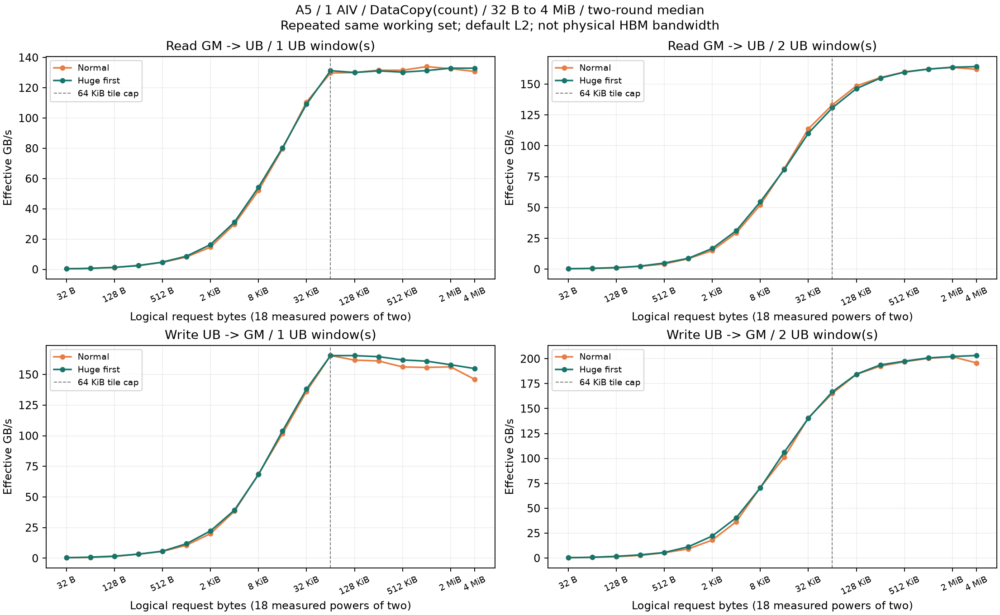
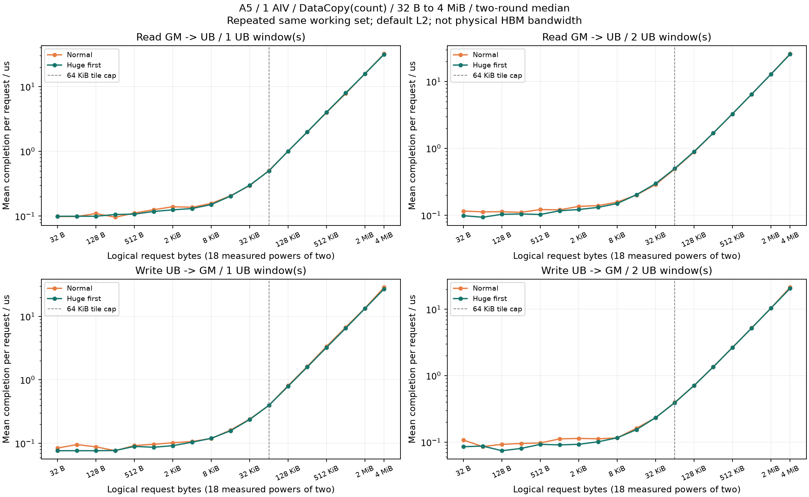

# A5 单 AIV：32 B 到 4 MiB 的完整请求扫描

已验收 **18 个倍增点、864 配置轮次、10368 个正式计时样本**，另有 10368 个关闭 trace 的对照启动。读、写 / 三种 API / 1、2 个 UB 窗口 / 普通页、大页优先 / 两轮均完整覆盖。历史原始数据保留。





设备：Ascend950DT_9582，CANN 9.1.0，1 个 AIV，实际 UB 221184 B，uint32，连续地址、无 gap。

## 总字节与 API 大小

横轴为一次完整请求的总字节，从 32 B 翻倍至 4 MiB；4 MiB 不是一次 DataCopy 的 UB Tensor。count / params 的 tile=min(总字节,64 KiB)，DataCopyPad(DataCopyParams) 的 uint16 字节长度使用 tile=min(总字节,32 KiB)。因此 4 MiB 分别需要 64 / 128 次连续 API 调用，UB 中仅保留 1/2 个 tile。

每请求结束时包含最后的完成等待，再处理下一请求。小请求最多重复 8192 次，大请求至少重复 4 次；SYS_CNT 总区间除以请求重复数，得到每请求平均完成耗时。双窗口只在一个请求内流水，不跨请求继续 DMA。初始化和结果导出不在该区间内；完整 kernel 的 ACL Event 与 trace-off 样本单独保留。

## 4 MiB：DataCopy(count)

| 方向 | UB 窗口 | 页策略 | 请求 p50 / μs | 有效 GB/s | 两轮 p50 / μs |
| --- | ---: | --- | ---: | ---: | --- |
| GM_UB | 1 | huge-first | 31.55200 | 132.933 | 31.55275 / 31.55125 |
| GM_UB | 1 | normal | 32.07762 | 130.755 | 32.41187 / 31.74338 |
| GM_UB | 2 | huge-first | 25.53994 | 164.225 | 25.53850 / 25.54138 |
| GM_UB | 2 | normal | 25.88450 | 162.039 | 25.86238 / 25.90662 |
| UB_GM | 1 | huge-first | 27.08900 | 154.834 | 27.07862 / 27.09938 |
| UB_GM | 1 | normal | 28.71663 | 146.058 | 28.66188 / 28.77137 |
| UB_GM | 2 | huge-first | 20.64056 | 203.207 | 20.65312 / 20.62800 |
| UB_GM | 2 | normal | 21.42075 | 195.806 | 21.33700 / 21.50450 |

## 全部 18 个点：双窗口大页优先 count

| 总字节 | tile × 次数 | 读 p50 / μs | 读 GB/s | 写 p50 / μs | 写 GB/s |
| --- | --- | ---: | ---: | ---: | ---: |
| 32 B | 32 B × 1 | 0.09849 | 0.325 | 0.08534 | 0.375 |
| 64 B | 64 B × 1 | 0.09350 | 0.685 | 0.08718 | 0.734 |
| 128 B | 128 B × 1 | 0.10344 | 1.237 | 0.07421 | 1.725 |
| 256 B | 256 B × 1 | 0.10463 | 2.447 | 0.08040 | 3.184 |
| 512 B | 512 B × 1 | 0.10288 | 4.977 | 0.09266 | 5.526 |
| 1 KiB | 1 KiB × 1 | 0.11677 | 8.769 | 0.09086 | 11.270 |
| 2 KiB | 2 KiB × 1 | 0.12199 | 16.789 | 0.09270 | 22.093 |
| 4 KiB | 4 KiB × 1 | 0.13124 | 31.211 | 0.10110 | 40.514 |
| 8 KiB | 8 KiB × 1 | 0.14998 | 54.620 | 0.11618 | 70.512 |
| 16 KiB | 16 KiB × 1 | 0.20267 | 80.841 | 0.15408 | 106.332 |
| 32 KiB | 32 KiB × 1 | 0.29742 | 110.175 | 0.23371 | 140.208 |
| 64 KiB | 64 KiB × 1 | 0.50104 | 130.800 | 0.39288 | 166.810 |
| 128 KiB | 64 KiB × 2 | 0.89559 | 146.352 | 0.71052 | 184.473 |
| 256 KiB | 64 KiB × 4 | 1.69204 | 154.928 | 1.35249 | 193.823 |
| 512 KiB | 64 KiB × 8 | 3.28182 | 159.755 | 2.65441 | 197.516 |
| 1 MiB | 64 KiB × 16 | 6.46461 | 162.203 | 5.22094 | 200.841 |
| 2 MiB | 64 KiB × 32 | 12.80791 | 163.739 | 10.36906 | 202.251 |
| 4 MiB | 64 KiB × 64 | 25.53994 | 164.225 | 20.64056 | 203.207 |

## 解释边界

输入和输出每配置新申请，申请容量至少 2 MiB；实际触达工作集等于请求总字节。普通页与大页优先采用同源码、同 CANN、同参数；HUGE_FIRST 可以回退，未查物理页表。默认 L2 且同一份数据反复访问，未采集缓存命中或物理 HBM 事务，不能将有效吞吐当作冷 HBM 总线带宽，也不能用它解释之前 2 GiB 多核扫描的上限。

独立的不计性能读回启动验证所有 tile 和 128 B guard；每个正式/预热启动再次校验完整写目标或最后 1/2 个完整 UB 窗口与 guard。计时读的早期 tile 已被覆盖，其校验范围与独立完整读 oracle 分开记录。

两轮配置顺序独立随机，页策略交替短批；trace 开/关顺序随机。全部样本保留，每个短批 Host/容器前后均无其他 NPU 进程，未证明两次快照间完全没有瞬时干扰。

该曲线的实现、tile、同步和计时协议与旧“单次 API”曲线有差别；页面将它作为“完整请求”实验单列，不直接拼接旧 API 上限。

时钟按匹配芯片的 [CANN GetSystemCycle 文档](https://www.hiascend.com/document/detail/en/CANNCommunityEdition/910/API/ascendcopapi/docs/en/api/SIMD-API/basic_api/tool_interface/system_resources_and_variables/GetSystemCycle_ISASI.md)换算，保留原始 tick、全部 ACL Event、开关对照与来源哈希。接收端核对任务终态、原始 tar 字节、源码/二进制、参数、时钟区间、占用和完整覆盖后发布。

## 复现

固定源码在 [experiments/a5_extent](https://github.com/Kirrito-k423/micro-benchmark-lab-web/tree/codex/a5-mbench-results/experiments/a5_extent)。确认目标芯片、CANN、UB、时钟及整机占用，空闲时分短任务执行：

```bash
cd experiments/a5_extent
python3 plan.py
bash build.sh
python3 run_stage.py --device 1 --key smoke-normal-v3 --output results/smoke-normal-v3
python3 run_stage.py --device 1 --key smoke-huge-first-v3 --output results/smoke-huge-first-v3
# 执行 execution-plan.json 中 round=1/2 的短批；每批运行前后再查整机占用。
python3 run_stage.py --device 1 --key r1-normal-00-v3 --output results/r1-normal-00-v3
```

```bash
python3 scripts/import-a5-extent.py /absolute/private/experiment --output public/data/a5-extent.json
uv run --no-project --with matplotlib python scripts/report-a5-extent.py --data public/data/a5-extent.json --report public/reports/a5-extent-20261011.md --figures public/figures
npm run build:pages
```

Source archive SHA-256：`24c7f6a9cbf104312dfd9990ff8180b561430379538ca8ece2e7142225ed4d03`。计划 SHA-256：`8e8aaa2673e294fc3c5e02ca2a8e84262ed5272407714f889e5e60dab54abc81`。
