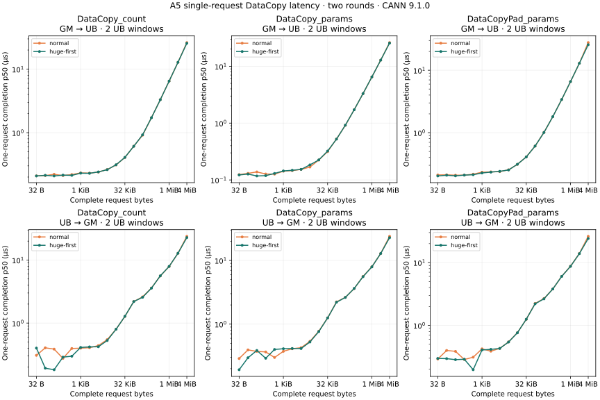
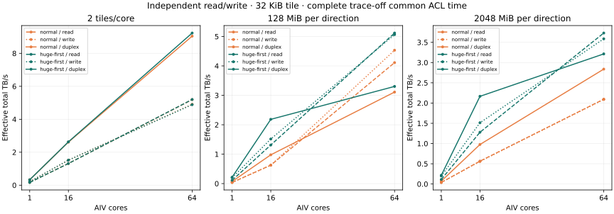

# A5 DataCopy：单请求完成延迟与独立地址双向带宽

2026-10-11 · Ascend950DT_9582 · CANN 9.1.0 · SYS_CNT 1 GHz。

完整两轮接收验收通过：864 个单请求配置轮次、216 个只读/只写/双向配置轮次、152 个空协议对照；合计 1,232 个配置轮次，14,784 个正式 trace 样本和同量 trace-off。预热另外保存。

## 测量定义

- 单请求：每个启动只完成一次请求，32 B 每次翻倍至 4 MiB，共 18 点。SYS_CNT 包含提交、窗口复用与最后 DMA 完成；初始化和结果导出在区间外。完整 kernel 的 trace 开/关 ACL 时间另外保留。没有把重复请求的平均耗时标成单次延迟。
- 双向：GM→UB 与 UB→GM 同一 kernel 先提交、后分别等待；两方向的 GM 和 UB 独立，每方向各两窗口。只读、只写、同时读写、空协议共用同一对 GM 分配，启动次序随机。
- 双向吞吐：读字节/T、写字节/T、两者之和/T 使用同一个完整 trace-off ACL Event 时间 T。包括初始化、核间同步、排空与保留读窗口导出；不相加独立模式或不同核的峰值。
- 页策略：数据输入/输出同时使用 NORMAL_ONLY 或 HUGE_FIRST。每个配置重新申请 GM；大页优先可回退，本实验没有读取物理页表。默认 L2；不能等同于冷 HBM 流量。

以下表格取两轮各自 p50 的中位数，p95 同样先在每轮 12 次正式样本内计算再取中位数。p95 是有限样本的观察值，不能代表长期生产尾延迟。完整参数、两轮所有样本和空协议对照保存在公开 JSON。

## 单 AIV、两窗口：一次完整请求的延迟



count / params 最大 64 KiB tile，Pad 最大 32 KiB tile。4 MiB 是由多个 tile 完成的请求，不是 UB 中一次 API 的 4 MiB shape。

### DataCopy_count

| 完整请求 | 普通页读 μs | 大页优先读 μs | 普通页写 μs | 大页优先写 μs |
|---|---:|---:|---:|---:|
| 32 B | 0.2088 | 0.2080 | 0.3070 | 0.4002 |
| 64 B | 0.2110 | 0.2130 | 0.4042 | 0.1920 |
| 128 B | 0.2210 | 0.2080 | 0.3855 | 0.1815 |
| 256 B | 0.2110 | 0.2145 | 0.2750 | 0.2875 |
| 512 B | 0.2190 | 0.2125 | 0.3947 | 0.2975 |
| 1 KiB | 0.2325 | 0.2300 | 0.3987 | 0.4100 |
| 2 KiB | 0.2305 | 0.2290 | 0.4062 | 0.4185 |
| 4 KiB | 0.2395 | 0.2410 | 0.4385 | 0.4205 |
| 8 KiB | 0.2625 | 0.2612 | 0.5450 | 0.5275 |
| 16 KiB | 0.3103 | 0.3120 | 0.7980 | 0.7963 |
| 32 KiB | 0.4070 | 0.4080 | 1.2735 | 1.2793 |
| 64 KiB | 0.6120 | 0.6100 | 2.1953 | 2.1938 |
| 128 KiB | 0.9128 | 0.9253 | 2.6058 | 2.5670 |
| 256 KiB | 1.7208 | 1.7178 | 3.6020 | 3.5827 |
| 512 KiB | 3.3095 | 3.2975 | 5.5993 | 5.6140 |
| 1 MiB | 6.4810 | 6.4860 | 7.9053 | 7.9335 |
| 2 MiB | 12.8317 | 12.8272 | 12.8372 | 12.8392 |
| 4 MiB | 26.2030 | 25.5405 | 23.8128 | 22.7370 |

### DataCopy_params

| 完整请求 | 普通页读 μs | 大页优先读 μs | 普通页写 μs | 大页优先写 μs |
|---|---:|---:|---:|---:|
| 32 B | 0.1242 | 0.1225 | 0.2885 | 0.1925 |
| 64 B | 0.1305 | 0.1270 | 0.3942 | 0.2965 |
| 128 B | 0.1385 | 0.1175 | 0.3735 | 0.3862 |
| 256 B | 0.1273 | 0.1190 | 0.3662 | 0.2913 |
| 512 B | 0.1265 | 0.1303 | 0.2997 | 0.4002 |
| 1 KiB | 0.1425 | 0.1440 | 0.3745 | 0.4110 |
| 2 KiB | 0.1460 | 0.1480 | 0.4110 | 0.4145 |
| 4 KiB | 0.1535 | 0.1535 | 0.4270 | 0.4138 |
| 8 KiB | 0.1688 | 0.1842 | 0.5368 | 0.5243 |
| 16 KiB | 0.2243 | 0.2250 | 0.7752 | 0.7630 |
| 32 KiB | 0.3153 | 0.3225 | 1.2520 | 1.2508 |
| 64 KiB | 0.5252 | 0.5222 | 2.2310 | 2.2035 |
| 128 KiB | 0.9130 | 0.9190 | 2.6330 | 2.6232 |
| 256 KiB | 1.7215 | 1.7157 | 3.6115 | 3.6282 |
| 512 KiB | 3.3007 | 3.3045 | 5.6132 | 5.5505 |
| 1 MiB | 6.4827 | 6.4878 | 7.9482 | 7.9158 |
| 2 MiB | 12.8305 | 12.8268 | 12.8465 | 12.8385 |
| 4 MiB | 26.0870 | 25.5400 | 23.8573 | 22.7213 |

### DataCopyPad_params

| 完整请求 | 普通页读 μs | 大页优先读 μs | 普通页写 μs | 大页优先写 μs |
|---|---:|---:|---:|---:|
| 32 B | 0.2100 | 0.2023 | 0.2910 | 0.2977 |
| 64 B | 0.2110 | 0.2077 | 0.3985 | 0.2955 |
| 128 B | 0.2080 | 0.2030 | 0.3858 | 0.2845 |
| 256 B | 0.2085 | 0.2088 | 0.2860 | 0.2890 |
| 512 B | 0.2160 | 0.2117 | 0.3113 | 0.1968 |
| 1 KiB | 0.2325 | 0.2258 | 0.4230 | 0.4060 |
| 2 KiB | 0.2353 | 0.2333 | 0.3880 | 0.4148 |
| 4 KiB | 0.2372 | 0.2400 | 0.4300 | 0.4290 |
| 8 KiB | 0.2538 | 0.2525 | 0.5457 | 0.5427 |
| 16 KiB | 0.3105 | 0.3115 | 0.7658 | 0.7615 |
| 32 KiB | 0.4090 | 0.4080 | 1.2473 | 1.2517 |
| 64 KiB | 0.6098 | 0.6098 | 2.2335 | 2.2045 |
| 128 KiB | 1.0110 | 1.0057 | 2.6730 | 2.6405 |
| 256 KiB | 1.8030 | 1.8043 | 3.7932 | 3.7910 |
| 512 KiB | 3.3898 | 3.3925 | 6.0267 | 6.0100 |
| 1 MiB | 6.5660 | 6.5730 | 8.7428 | 8.6860 |
| 2 MiB | 12.9253 | 12.9125 | 13.9383 | 13.8295 |
| 4 MiB | 27.7365 | 25.6270 | 26.1145 | 24.1133 |

## 64 AIV、32 KiB tile：同一分配上的配对比较



工作集容量指每方向；读写同时打开时，读、写各请求 4 GiB，合计 8 GiB。独立模式每次请求 4 GiB。小范围模式每核保留两个 tile，共 4 MiB 每方向。

| 每方向工作集 | 页策略 | 只读 TB/s | 只写 TB/s | 同时读 TB/s | 同时写 TB/s | 同时合计 TB/s | 同时共同 T μs |
|---|---|---:|---:|---:|---:|---:|---:|
| 4 MiB | normal | 5.1927 | 4.9079 | 4.5222 | 4.5222 | 9.0445 | 949.746 |
| 4 MiB | huge-first | 5.2010 | 4.8874 | 4.6164 | 4.6164 | 9.2328 | 930.375 |
| 128 MiB | normal | 4.1107 | 4.5326 | 1.5553 | 1.5553 | 3.1107 | 2761.431 |
| 128 MiB | huge-first | 5.1170 | 5.0646 | 1.6513 | 1.6513 | 3.3026 | 2601.000 |
| 2 GiB | normal | 2.0950 | 2.0883 | 1.4191 | 1.4191 | 2.8382 | 3026.556 |
| 2 GiB | huge-first | 3.7294 | 3.5861 | 1.6070 | 1.6070 | 3.2140 | 2672.685 |

同时读写的读/写请求量相等，两个方向展示相同的“字节/共同完成时间”，这是该口径的定义，并不表示两方向真实精确完成时刻相同。核内 Scalar 读/写完成观察戳只作为完成上界保存，不能作为独立方向带宽分母。

1 / 16 / 64 AIV、4 / 32 KiB tile、三种工作集、两页策略和两轮的全部对照可以在交互页面筛选。页面按同一共同时间分别列读、写、合计，并联动单轮样本和固定源码。

## 正确性与证据边界

每次分配有独立 untimed 全 tile 读取 oracle。每个正式启动验证完整写目标或未改写目标、最后两个完整保留读窗口和 128 B guard；早先被覆盖的 timed read tile 不逐个导出。Host 和容器整机占用在短任务前后均为空，两次快照之间的瞬时干扰未知。

独立地址不能排除共享缓存、内存 bank / 通道或其他资源竞争。本实验没有采集 bank/TLB/cache/HBM 计数器，不把差异归因为已确认的 bank conflict，也不宣称硬件始终完全重叠。空协议保留原值、不盲目扣除。

SYS_CNT 换算依据匹配目标芯片与 CANN 版本的[官方 GetSystemCycle 文档](https://www.hiascend.com/document/detail/en/CANNCommunityEdition/910/API/ascendcopapi/docs/en/api/SIMD-API/basic_api/tool_interface/system_resources_and_variables/GetSystemCycle_ISASI.md)。核内区间与共同 ACL Event / Host 区间交叉核对；公开 ticks 是各核相对值，不拼接不同核时钟。

## 复现与源码绑定

[固定源码](https://github.com/Kirrito-k423/micro-benchmark-lab-web/tree/2a8a87a781867e532581dfd52aae857ac1819775/experiments/a5_latency_duplex)；运行参数、构建步骤和 oracle 范围见目录 README。先确认整机空闲并持有自己的短预约，按固定 execution-plan.json 的四个冒烟阶段验证，再跑两轮正式短批。输出目录必须全新。

```bash
python3 plan.py
bash build.sh
python3 run_stage.py --device DEVICE --key PLAN_STAGE --output FRESH_OUTPUT
```

接收端拒绝未知/非终态任务、缺失覆盖、归档或样本哈希不符、错配源码/构建、错误输出、非法时钟和占用。配置、计时样本、源码绑定和构建凭据全部绑定；原始归档私有保存。

- 源码 commit：`2a8a87a781867e532581dfd52aae857ac1819775`
- 源码归档 SHA-256：`71e733ed8db9ac13a73729fc3ecb08c2a3f70e45f9388037295c51c12ff13cd9`
- 计划 SHA-256：`fde941726fddcd7d4a7e483c6b6ad9fb505285176c9653b62719388238e0ea47`
- latency 二进制 SHA-256：`a6831526ade5af6f70dac41378e7b1b9dee7ff2e7755174d836dbd7edc1c701d`
- duplex 二进制 SHA-256：`bfa82713917e10484c09132a03c2b9439d75a1e7befb2d9b65406787492d6cb7`
